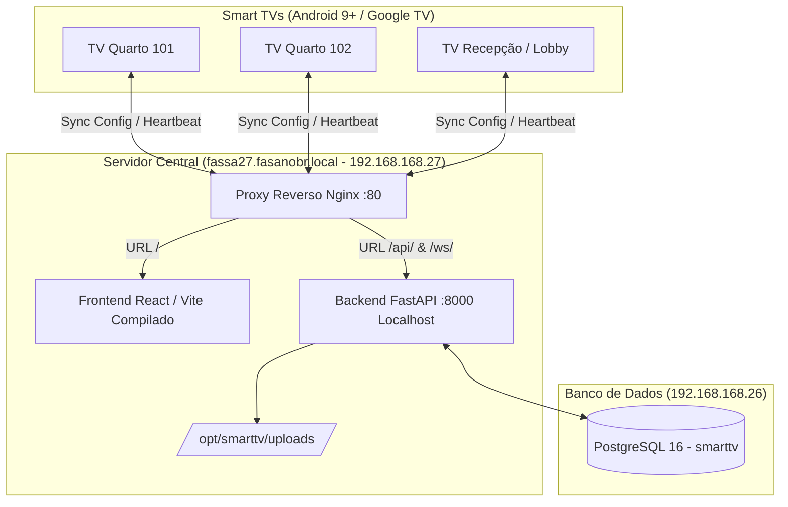

# SmartTV Manager - Sistema de Gestão de Smart TVs & Launcher Android

Sistema completo e centralizado para gerenciamento de Smart TVs (Android TV / Google TV a partir do Android 9.0+), projetado para hotelaria, clínicas, ambientes corporativos e lounges.

---

## 🌐 URLs de Produção no Servidor (Sem Portas Expostas)

O sistema está implantado no servidor corporativo e opera através de **Proxy Reverso Nginx** na porta 80 padrão:

* **Painel Web Administrativo:** [http://fassa27.fasanobr.local/](http://fassa27.fasanobr.local/) (ou [http://192.168.168.27/](http://192.168.168.27/))
* **Swagger / Documentação da API:** [http://fassa27.fasanobr.local/docs](http://fassa27.fasanobr.local/docs)
* **Banco de Dados (PostgreSQL 16):** `192.168.168.26:5432` (banco `smarttv`)

---

## 🔄 Fluxo de Atualização Automática (Git Diff & Update)

Implementamos o fluxo completo de sincronização entre o seu computador de desenvolvimento e o servidor:

### 1. No seu Computador (Windows):
Sempre que fizer alterações no código, basta executar:
```bash
.\git_push_update.bat
```
*(ou manualmente: `git add -A && git commit -m "mensagem" && git push origin main`)*

### 2. No Servidor (`fassa27.fasanobr.local`):
Conecte-se via SSH (`ssh root@fassa27.fasanobr.local`) e execute o comando:
```bash
smarttv-update
```
O script inteligente realiza automaticamente:
1. `git fetch origin main`
2. Analisa o `git diff` e mostra na tela exatamente o que mudou.
3. Se o frontend tiver mudanças, roda o `npm run build` automaticamente com Node 22 LTS.
4. Se o backend tiver novos pacotes em `requirements.txt`, atualiza o virtualenv.
5. Reinicia os serviços `smarttv-backend` e recarrega o Nginx sem derrubar conexões ativas.

---

## 🎨 Correção dos Ícones e Animação Selecionada

### 1. Na TV (APK Android TV / Google TV):
* O APK **não cria ícones genéricos**.
* Através do `PackageManager`, o app consulta diretamente o sistema operacional da TV:
  ```kotlin
  val banner = packageManager.getApplicationBanner(sc.packageName)
  val icon = packageManager.getApplicationIcon(sc.packageName)
  ```
* Se o aplicativo já estiver instalado fisicamente na TV (como Netflix, YouTube, Prime Video, Globoplay, Disney+), o Launcher puxa e exibe o **banner oficial em alta resolução** registrado pelo próprio fabricante do app.

### 2. No Painel Web & Simulador:
* Logotipos oficiais vetorizados em SVG (Netflix, Disney+, YouTube, Prime Video, Globoplay, Max, Spotify e SKY HD).
* Animação do card focado corrigida: elevação sutil `scale(1.10)` com easing suave (`cubic-bezier`), iluminação halo (`box-shadow`), z-index elevado e espaçamento interno que impede o corte/cegamento nas bordas do container.

---

## 🏛️ Arquitetura do Sistema



---

## 📺 Aplicativo Android TV (APK)
Localizado na pasta [android-tv-app/](file:///c:/Users/diego.reis/Documents/DEV/SMARTTV/android-tv-app):
* Suporte a Android 9.0+ (API 28+).
* Player com **Media3 ExoPlayer** e **Cache Local de 2GB** para reprodução contínua mesmo se a rede oscilar.
* Troca direta para entrada HDMI da Sky via `TvInputManager` (TIF).
* Inicialização automática ao ligar a TV (`BOOT_COMPLETED`) e botão Home atribuído.
