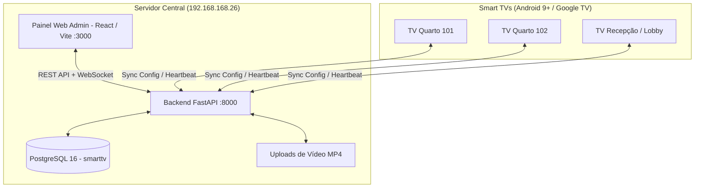

# SmartTV Manager - Sistema de Gestão de Smart TVs & Launcher Android

Sistema completo e centralizado para gerenciamento de Smart TVs (Android TV / Google TV a partir do Android 9.0+), projetado para hotelaria, clínicas, ambientes corporativos e lounges.

---

## 🏛️ Arquitetura do Sistema



---

## 🚀 Como Iniciar o Sistema

### 1. Iniciar o Backend (FastAPI + PostgreSQL):
Basta executar o script:
```bash
.\start_backend.bat
```
Ou manualmente pelo terminal:
```bash
cd backend
.\venv\Scripts\python.exe -m uvicorn app.main:app --host 0.0.0.0 --port 8000 --reload
```
* **URL da API:** `http://localhost:8000`
* **Swagger / Documentação Interativa:** `http://localhost:8000/docs`

### 2. Iniciar o Painel Web (Frontend):
Basta executar o script:
```bash
.\start_frontend.bat
```
Ou manualmente pelo terminal:
```bash
cd frontend
npm run dev
```
* **URL do Painel:** `http://localhost:3000` (disponível na rede local para qualquer computador ou tablet).

---

## 📺 Principais Módulos

### 1. Gestão Individualizada de Cada TV
* **Nome e Localização:** Ex: *"Suíte Master 101"*, *"Lobby Principal"*.
* **Layout da Tela:** Escolha entre 4 modelos visuais:
  1. *Hotel Luxo:* Vídeo em tela cheia com barra inferior (dock translúcido com glassmorphism).
  2. *Split Screen Corporativo:* Vídeo 70% + Painel lateral 30% com relógio, clima, QR Code de Wi-Fi e lista de apps.
  3. *Vitrine Minimalista:* Vídeo 100% contínuo, menu oculto que surge ao toque de qualquer tecla.
  4. *Mural Informativo:* Vídeo de fundo com letreiro de notícias/avisos correndo na parte inferior (ticker).
* **Entrada HDMI Sky Customizada:** Defina qual porta física (`HDMI 1`, `HDMI 2`, `HW1`) está conectada ao decodificador Sky e personalize o nome exibido (ex: *"TV SKY HD"*).
* **Atalhos Selecionados:** Escolha individualmente quais apps cada TV pode acessar (Netflix, YouTube, Globoplay, Prime Video, Disney+, Max, etc.).
* **Mensagens e Wi-Fi:** Personalize o título de boas-vindas e a senha de Wi-Fi exibida na tela.

### 2. Módulo de Vídeos e Playlists Contínuas
* Upload de vídeos em MP4/WebM diretamente pelo painel.
* Streaming com suporte a **HTTP Range Requests (206)** para reprodução imediata sem travamentos.
* Criação de playlists com ordenação sequencial e repetição contínua (loop).

### 3. Simulador Interativo de TV (No Navegador)
* Permite que o administrador teste a interface da TV diretamente pelo painel.
* Simula a navegação pelo controle remoto (setas ◀ ▶ do teclado físico e botão Enter).
* Testa a alternância para a SKY HDMI e a abertura simulada de apps.

### 4. APK Android TV (Android 9.0+)
* Localizado na pasta `android-tv-app/`.
* Utiliza **Media3 ExoPlayer** com cache em disco (`SimpleCache` de 2GB): se a internet da TV cair, os vídeos continuam passando normalmente direto do armazenamento interno.
* Registrado como **Home Launcher** e auto-inicia com a TV (`BOOT_COMPLETED`).
* Pareamento por código PIN: a TV exibe um código de 6 dígitos ao ligar para ser ativada com 1 clique no painel web.

---

## 🗄️ Dados de Conexão com o Banco de Dados

* **Host:** `192.168.168.26`
* **Porta:** `5432`
* **Usuário:** `postgres`
* **Senha:** `6ffdd4a3d0e99d78b1e15f411b04e323`
* **Banco de Dados:** `smarttv`
